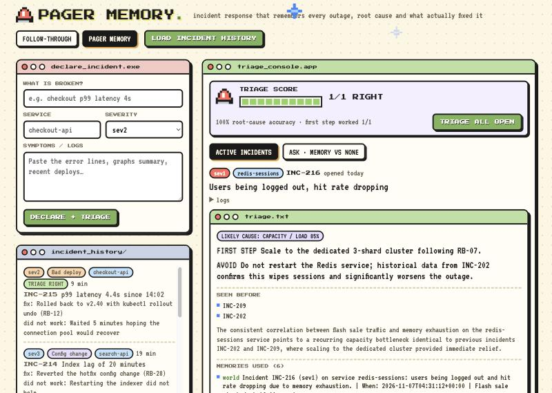
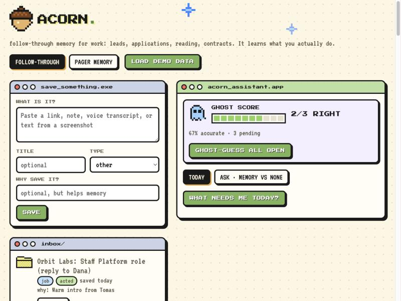

# Acorn-Hindsight: AI agents that remember what worked

**Acorn-Hindsight is one memory engine with two small web apps on top of it:**

- **Pager Memory** (`/pager`): incident response. It remembers every outage, its root cause, the fix that worked and
  the fixes that wasted time. When a new incident opens it triages from your team's history, then grades itself.
- **Acorn Follow-through** (`/`): it remembers what you saved (leads, applications, articles, contracts) and what you
  actually *did* with it, so it can say what deserves attention today.

**What is Hindsight?** [Hindsight](https://github.com/vectorize-io/hindsight) ([docs](https://hindsight.vectorize.io/)) is an
open-source memory system for AI agents. You `retain` what happened, and later `recall` it or `reflect` over it (an
agent that reasons across many memories and answers in plain language). A **bank** is one isolated memory store.
Each app here has its own bank, so incident history never mixes with your saved items.

The point of both apps: **memory is the product.** Without it an agent gives generic advice. With it, it cites your own
history and keeps improving as you use it.

## Know before you start
- **Demo data is synthetic.** It is written with recurring patterns so learning is visible, so triage on the seeded
  incidents is easy. The accuracy score only means something as you resolve new incidents.
- **Hindsight Cloud calls take 5 to 25 seconds.** Triage and Ask show a loading bar; it is not hung.
- **Storage is single-user:** a JSON file per app for the inbox the UI lists (Hindsight holds the memory).

## Try it in 2 minutes
**Prerequisites:** Python 3, and a Hindsight key from [Hindsight Cloud](https://ui.hindsight.vectorize.io) (or run
Hindsight locally with Docker, below). A Groq key is optional.

```bash
python3 -m venv .venv && .venv/bin/pip install -r requirements.txt
cp .env.example .env          # then fill in the values below
.venv/bin/uvicorn app.main:app --reload
```

| `.env` value | Needed? | What it does |
|---|---|---|
| `HINDSIGHT_BASE_URL` | yes | `https://api.hindsight.vectorize.io` for Cloud, or `http://localhost:8888` for local Docker |
| `HINDSIGHT_API_KEY` | yes for Cloud, not for local | your Hindsight key |
| `GROQ_API_KEY` | optional | only powers the "without memory" column in the Ask tab; the app works without it |
| `ACORN_USER` | optional | names your banks (default `demo`) |

Prefer Hindsight on your machine? `docker run -p 8888:8888 -p 9999:9999 -e HINDSIGHT_API_LLM_API_KEY=... ghcr.io/vectorize-io/hindsight:latest`

**Worked example (Pager Memory):**
1. Open http://localhost:8000/pager and click **LOAD INCIDENT HISTORY** (14 past incidents + 4 live ones, about 18
   memories). Wait about 30 seconds for Hindsight to index them.
2. Click **TRIAGE ALL OPEN**. Take incident **INC-217**, "Webhook 504s, retries piling up" on `payments-api`. It
   comes back as *Dependency outage*, with the first step "enable the fallback retry queue (RB-19)" and an **AVOID**
   line: do not roll back, because history shows rolling back `payments-api` does not help provider outages (it wasted 20 minutes in INC-203). Similar incidents: INC-203, INC-210.
3. Open the **Ask** tab and ask "Redis is evicting keys. What do I do first, and what should I NOT do?". A generic bot
   gives textbook steps. Pager Memory says scale to the dedicated cluster (RB-07) and do **not** restart Redis,
   because restarting wiped every session in INC-202.
4. Click **Resolve...** on INC-215, pick the real root cause and save. If triage said *Bad deploy* and you pick
   *Bad deploy*, the toast says **RIGHT**, the score becomes 1/1, and "the triage was RIGHT" is retained as a memory
   for next time. Pick a different cause and it records WRONG instead.




Acorn Follow-through is at http://localhost:8000: click **LOAD DEMO DATA**, then try **Today**, **Ghost-guess all open**
and the **Ask** tab. Check your Hindsight connection any time with `.venv/bin/python -m scripts.smoke`.

## How Hindsight memory is used
Everything the apps know about history comes from Hindsight; the local JSON file only holds the inbox list.

| Moment | Hindsight call | Why |
|---|---|---|
| Something is saved or an incident opens | `retain` with timestamp, tags, context and a stable `document_id` | Hindsight extracts typed facts and entities, so history stays searchable by meaning, time and entity |
| You act on / ignore an item, or resolve an incident | `retain` an **outcome** fact (what happened, how fast, what did not work) | Saving is cheap; *outcomes* are the learning signal |
| Brief, Today, triage, Ask | `reflect` over the whole bank (structured schema for triage) | The agent reasons over patterns across many memories, not just the nearest one |
| A prediction is graded | `retain` "predicted X, the truth was Y, so it was right/wrong" | The agent learns from its own misses |
| Demo setup | `retain_batch` with backdated timestamps | Realistic multi-week history |

Design decisions:
- **One bank per app** (`acorn-<user>` for Follow-through, `acorn-<user>-pager` for Pager Memory), each with its own
  bank mission and retain mission so extraction focuses on the right facts (outcomes and "did NOT work" for incidents;
  behaviour for follow-through).
- **Outcomes over notes.** The most valuable memory is not "INC-204 happened" but "raising max_connections only
  delayed it 10 minutes". Triage surfaces these as **AVOID** lines.
- **Self-grading loop.** Ghost Predictions (Follow-through) and triage (Pager Memory) store their guess *before* you
  act, grade it afterwards, and retain the verdict. The running accuracy score is the visible proof of learning.
- **Authoritative state next to memory.** Hindsight supplies history and patterns; the app also passes the real
  open/acted/resolved status into each question so the model cannot mislabel a finished item as pending.
- **Honest baseline.** The Ask tab sends the same question to a plain LLM with no memory, side by side.


## Optional: an OpenClaw agent on the same memory
[OpenClaw](https://github.com/openclaw/openclaw) is an open-source personal AI agent platform. It is not needed to
run the apps. Its official Hindsight plugin lets an OpenClaw agent read the same bank, so you can ask it about an
outage in chat. Verified end to end; setup and the problems we hit are in [docs/openclaw.md](docs/openclaw.md).

## Features
**Pager Memory** (`app/pager.py`): declare incident, triage from memory (cause, confidence, first step, avoid,
similar incidents), resolve with a post-mortem, graded root-cause accuracy and "first step worked" rate, Ask with vs
without memory.
**Acorn Follow-through** (`app/agent.py`): save items with a reason, mark acted/ignored, Brief me, Today (deadlines
first, then your track record), **Ghost Predictions** (guess act/ignore with confidence, graded when you click), Ask
with vs without memory, and an "earlier answer" view that shows how an answer changed after your actions.

## Path to adoption
Pager Memory is a working prototype, not a finished product. Here is what already supports real use, and what a team would still need.

**Works today**
- **Self-hostable:** run Hindsight locally with Docker (see "Try it in 2 minutes") so incident data never leaves your network.
- **Structured post-mortems:** every resolved incident captures cause, the fix that worked, what did *not* work, minutes to resolve and the runbook. That is what the agent learns from.
- **A built-in trust signal:** triage is graded against the real root cause, so a team can watch the accuracy score before relying on it.
- **Optional chat front end:** an OpenClaw agent can answer from the same memory (verified, see [docs/openclaw.md](docs/openclaw.md)).
- **MIT licensed.**

**Roadmap (not built yet)**
1. **Import real history:** bulk-load existing post-mortems and tickets (Markdown, PagerDuty, Opsgenie or Jira exports) instead of the synthetic seed.
2. **Live ingestion:** open an incident from a Slack message or a PagerDuty webhook, and post the triage back to the channel.
3. **Teams and access:** login, one bank per team, role-based access, and an audit log of what the agent recalled.
4. **Measure it on real incidents:** track triage accuracy and time to resolve before and after adoption, so the case rests on data and not a demo.
5. **Production hardening:** replace the single-user JSON inbox with a database, add CI, and stream answers to hide the 5 to 25 second Hindsight Cloud latency.

## Tests
`.venv/bin/python -m pytest` (28 tests, no network or key needed; they use a fake memory backend and cover retain
content, grading, clamping, state guards, seed patterns and the single-thread Hindsight client wrapper).

## Layout
```
app/memory.py   Hindsight wrapper (retain/recall/reflect, all calls on one thread)
app/agent.py    Acorn Follow-through: save, resolve, brief, today, ghost predictions, ask
app/pager.py    Pager Memory: incidents, triage, resolve, score, seed history
app/main.py     FastAPI routes
static/         Plain HTML/CSS/JS pixel UI (no build step)
openclaw/, docs/openclaw.md   OpenClaw plugin config and setup notes
```

## License
MIT, see [LICENSE](LICENSE).
