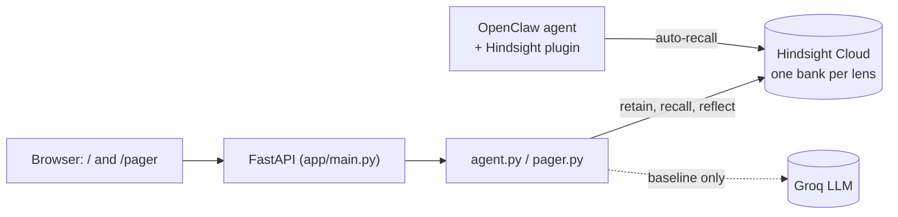

# Acorn: agents that remember what worked

Two products on one memory engine, both built on [Hindsight](https://github.com/vectorize-io/hindsight)
([docs](https://hindsight.vectorize.io/)):

- **Pager Memory** (`/pager`): incident response that remembers every outage, its root cause, the fix that worked and
  the fixes that wasted time. When a new incident opens it triages from your team's history, then grades itself.
- **Acorn** (`/`): follow-through for work. It remembers what you saved (leads, applications, articles, contracts)
  and, more importantly, what you actually *did* with it, so it can tell you what deserves attention today.

The point of both: **memory is the product.** Without it the agent gives generic advice. With it, it cites your own
history and gets measurably better as you use it.

## See it in 60 seconds (Pager Memory)
1. Open `/pager`, click **LOAD INCIDENT HISTORY** (14 past incidents + 4 live ones, about 18 memories).
2. **TRIAGE ALL OPEN.** Each live incident gets a likely root cause, a calibrated confidence, one first step with its
   runbook, what to *avoid*, and the past incidents it matches.
3. **Ask** tab: "Redis is evicting keys. What do I do first, and what should I NOT do?" A generic SRE bot gives textbook
   steps. Pager Memory says: scale to the dedicated cluster (RB-07) and do **not** restart Redis, because restarting
   wiped every session in INC-202.
4. **Resolve** an incident with its real root cause. The triage is graded right or wrong, the post-mortem is retained,
   and the score updates. Next triage can use that lesson.


## How Hindsight memory is used
Everything the agent knows comes from Hindsight; there is no other knowledge store for history (the local JSON file
only holds the inbox the UI lists).

| Moment | Hindsight call | Why |
|---|---|---|
| Something is saved or an incident opens | `retain` with timestamp, tags, context and a stable `document_id` | Hindsight extracts typed facts and entities, so history stays searchable by meaning, time and entity |
| You act on / ignore an item, or resolve an incident | `retain` an **outcome** fact (what happened, how fast, what did not work) | Saving is cheap; *outcomes* are the learning signal |
| Brief, Today, triage, Ask | `reflect` over the whole bank (structured schema for triage) | The agent reasons over patterns across many memories, not just the nearest one |
| A prediction is graded | `retain` "Acorn predicted X, the truth was Y, so it was right/wrong" | The agent learns from its own misses |
| Demo setup | `retain_batch` with backdated timestamps | Realistic multi-week history |

Design decisions:
- **One bank per lens** (`acorn-<user>`, `acorn-<user>-pager`), each with its own bank mission and retain mission so
  extraction focuses on the right facts (outcomes and "did NOT work" for incidents; behaviour for follow-through).
- **Outcomes over notes.** The most valuable memory is not "INC-204 happened" but "raising max_connections only
  delayed it 10 minutes". Triage surfaces these as **AVOID** lines.
- **Self-grading loop.** Ghost Predictions (Acorn) and triage (Pager Memory) store their guess *before* you act, grade
  it afterwards, and retain the verdict. The running accuracy score is the visible proof of learning.
- **Authoritative state next to memory.** Hindsight supplies history and patterns; the app also passes the real
  open/acted/resolved status into each question so the model cannot mislabel a finished item as pending.
- **Honest baseline.** The Ask tab sends the same question to a plain LLM with no memory, side by side.
- **Shared memory.** An OpenClaw agent can read the same bank through the official Hindsight plugin
  ([docs/openclaw.md](docs/openclaw.md)); verified end to end.



## Features
**Pager Memory** (`app/pager.py`): declare incident, triage from memory (cause, confidence, first step, avoid,
similar incidents), resolve with a post-mortem, graded root-cause accuracy and "first step worked" rate, Ask with vs
without memory.
**Acorn** (`app/agent.py`): save items with a reason, mark acted/ignored, Brief me, Today (deadlines first, then your
track record), **Ghost Predictions** (guess act/ignore with confidence, graded when you click), Ask with vs without
memory, "earlier answer" view that shows how an answer changed after your actions.

## Run
```bash
python3 -m venv .venv && .venv/bin/pip install -r requirements.txt
cp .env.example .env        # HINDSIGHT_BASE_URL + HINDSIGHT_API_KEY (Cloud or local), optional GROQ_API_KEY
.venv/bin/uvicorn app.main:app --reload
```
Open http://localhost:8000 (Acorn) or http://localhost:8000/pager (Pager Memory) and use the **Load ... history**
button. Check the connection any time with `.venv/bin/python -m scripts.smoke`.

Local Hindsight instead of Cloud:
`docker run -p 8888:8888 -p 9999:9999 -e HINDSIGHT_API_LLM_API_KEY=... ghcr.io/vectorize-io/hindsight:latest`

## Tests
`.venv/bin/python -m pytest` (28 tests, no network or key needed; they use a fake memory backend and cover retain
content, grading, clamping, state guards, seed patterns and the single-thread Hindsight client wrapper).

## Layout
```
app/memory.py   Hindsight wrapper (retain/recall/reflect, all calls on one thread)
app/agent.py    Acorn: save, resolve, brief, today, ghost predictions, ask
app/pager.py    Pager Memory: incidents, triage, resolve, score, seed history
app/main.py     FastAPI routes
static/         Plain HTML/CSS/JS pixel UI (no build step)
openclaw/, docs/openclaw.md   OpenClaw plugin config and setup notes
```

## Status and limits (honest)
- The demo data is synthetic, written with deliberate recurring patterns so learning is visible. The triage on the
  seeded incidents is therefore easy; the accuracy score only means something as you resolve new incidents.
- Hindsight Cloud calls take 5 to 25 seconds, so triage and Ask show a loading bar.
- Local storage is a JSON file per lens and is single-user; it is not a multi-tenant design.
- The OpenClaw agent recalls memory only from real chat surfaces (dashboard, terminal chat, channels).
